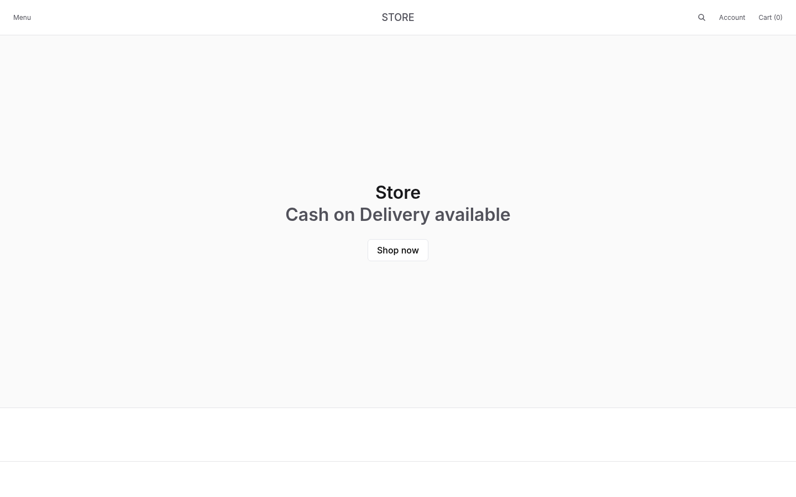
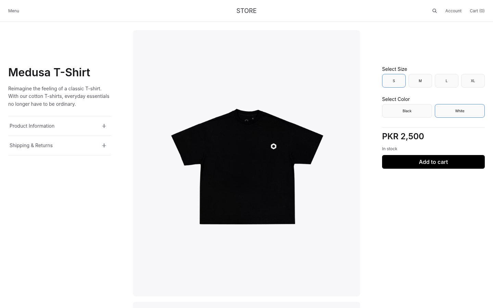
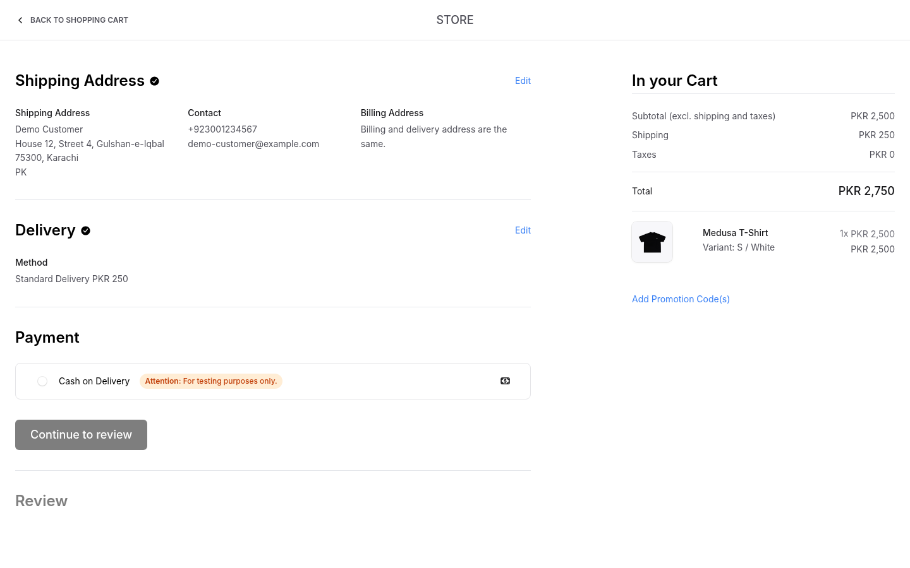
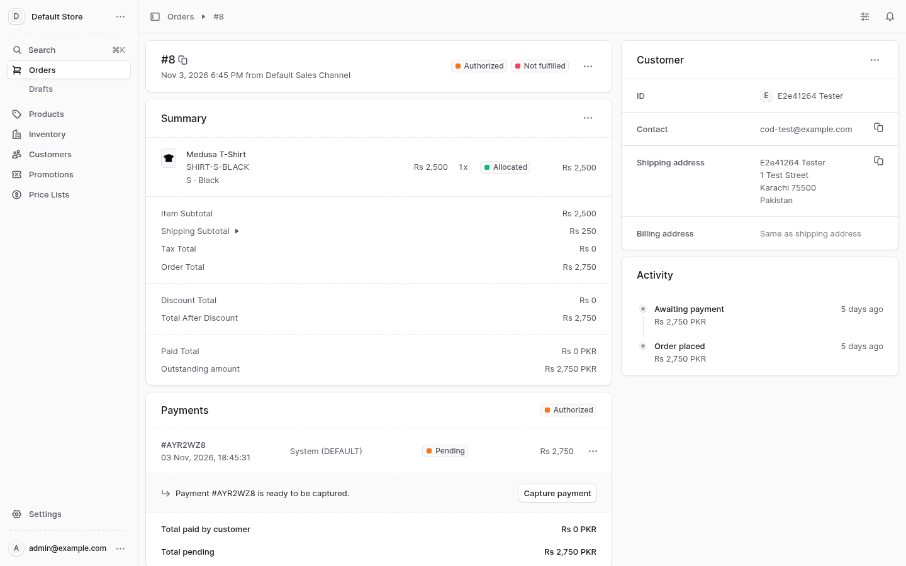

# My Medusa Store

A Pakistan-focused store built on [Medusa](https://docs.medusajs.com) v2 with the Next.js starter storefront. Currency is PKR and Cash on Delivery is the main payment method.

This repository is the foundation only. The COD placeholder is Medusa's built-in manual payment provider. Custom payment, courier and WhatsApp modules come later.

| App | Path | URL |
| --- | --- | --- |
| Backend API | `apps/backend` | http://localhost:9000 |
| Admin dashboard | `apps/backend` | http://localhost:9000/app |
| Storefront | `apps/storefront` | http://localhost:8000 |

## What's custom here

The repository starts from Medusa's DTC starter, a Turborepo with the backend and the Next.js storefront. The work on top of it:

- **Pakistan setup.** [`setup-pakistan.ts`](apps/backend/src/scripts/setup-pakistan.ts) sets up:
  - PKR as the default currency;
  - the Pakistan region, with Cash on Delivery through Medusa's manual payment provider;
  - a warehouse with flat-rate shipping;
  - the storefront's publishable key.

  It is safe to re-run and never overwrites changes made in the admin.
- **Locked-down store returns.** `POST /store/returns` is open by default in Medusa. [Middleware](apps/backend/src/api/middlewares/restrict-store-returns.ts) now requires the logged-in customer who owns the order. It also blocks fields a customer should not set: the return shipping price, the stock location and "receive now". Covered by unit tests.
- **Private files.** Order exports no longer land in the public `static` folder in production. [`medusa-config.ts`](apps/backend/medusa-config.ts) uses a private upload folder, or S3 when configured.
- **COD after an order edit.** An [integration test](apps/backend/integration-tests/http/cod-capture-after-order-edit.spec.ts) shows what Medusa does when staff edit a COD order down before collecting the cash. The original payment is cancelled, a new unpaid one opens for the new total, and the old amount can no longer be captured.
- **Demo data removal.** [`remove-europe-demo.ts`](apps/backend/src/scripts/remove-europe-demo.ts) lists the seeded Europe data first, then deletes it only on confirmation. It works around a Medusa bug where moving a reservation leaves its quantity reserved at the old location ([medusajs/medusa#17215](https://github.com/medusajs/medusa/issues/17215)).
- **Storefront.**
  - Cash on Delivery wording through checkout and order pages.
  - Store name from an environment variable.
  - Title templates and canonical URLs.
  - Related products by category, then collection, without sold-out items.
  - Search that retries with typo tolerance when an exact search finds nothing.
  - Prices and regions that refresh instead of being cached forever.
- **Bug write-ups.** [Moving a reservation leaves stock reserved at the old location](docs/findings/reservation-move-keeps-stock-reserved.md), a Medusa bug worked around here, and [the starter storefront keeps deleted regions](docs/findings/storefront-keeps-deleted-regions.md), fixed here.
- **Research.** 18 reports comparing Shopify's features with a Medusa build for the Pakistani market, in [`docs/shopify-research`](docs/shopify-research/README.md), and a phased [implementation backlog](docs/implementation-backlog.md).

## Screenshots

| Storefront | Product page |
| --- | --- |
|  |  |

| Checkout with Cash on Delivery | Admin order awaiting cash |
| --- | --- |
|  |  |

## Prerequisites

- Node.js 24 LTS. The exact version is in `.nvmrc`, so `nvm use` selects it. Medusa needs 22.23.4 or later, and the storefront does not support Node 25 or later.
- npm 11, which comes with that Node version
- Docker with Compose v2
- Free local ports: 9000, 8000, 5432 and 6380

## Setup from a clean clone

Run these from the repository root.

```bash
nvm use

# 1. Create local env files. The defaults work as they are.
cp .env.example .env
cp apps/backend/.env.example apps/backend/.env
cp apps/storefront/.env.example apps/storefront/.env.local

# 2. Start Postgres and Redis, and wait until both are healthy
docker compose up -d --wait

# 3. Install exact dependency versions from the lockfile
npm ci

# 4. Create the schema and the demo data
(cd apps/backend && npx medusa db:migrate)

# 5. Apply the Pakistan config. This also fills in the storefront's publishable key.
npm run setup:pakistan

# 6. Remove the Europe demo data from step 4. The first command only lists it.
npm run remove:europe-demo
CONFIRM_DELETE=1 npm run remove:europe-demo

# 7. Create a local admin user
(cd apps/backend && npx medusa user -e admin@example.com -p supersecret)
```

## Start commands

Run each in its own terminal, after `docker compose up -d --wait`:

```bash
cd apps/backend && npm run dev
cd apps/storefront && npm run dev
```

The first page load in dev mode is slow because Next.js compiles each route on demand.

To stop the databases, run `docker compose down`. Your data stays in the named volumes. `docker compose down -v` deletes it.

## Tests

```bash
cd apps/backend
npm run test:unit

# Integration tests create and drop their own throwaway database. They read
# the Postgres login from DB_* variables, not from DATABASE_URL.
DB_USERNAME=medusa DB_PASSWORD=medusa npm run test:integration:http
```

The values above are the development defaults from `.env.example`. `DB_HOST` and `DB_PORT` default to `localhost` and `5432`.

## Admin users

```bash
cd apps/backend
npx medusa user -e <email> -p <password>
```

The credentials in the setup steps are for local development only. Use a strong, unique password anywhere else.

## Pakistan config script

```bash
npm run setup:pakistan
```

The script is `apps/backend/src/scripts/setup-pakistan.ts`. It sets up:

- PKR as the store's default currency
- The "Pakistan" region (PKR, country PK) with `pp_system_default` as the COD placeholder
- The "Pakistan Warehouse" stock location, linked to the default sales channel
- A "Standard Delivery" flat-rate manual shipping option at PKR 250
- PKR 2,500 prices and stock for the four demo products
- A publishable API key on the default sales channel, written to `apps/storefront/.env.local`

It is safe to re-run. Everything is looked up first and only created when missing, so edits made in the admin are kept. To change a value such as the shipping price after the first run, change it in the admin.

The placeholder prices apply only to the four seeded demo products, so a re-run cannot touch real products.

Medusa stores prices in major units, so `2500` means PKR 2,500 and not paisa. PKR has no decimal places in Medusa.

## Removing the Europe demo data

The seed in step 4 also creates a Europe region, a "European Warehouse", tax regions for seven European countries, and EUR and USD store currencies. `apps/backend/src/scripts/remove-europe-demo.ts` deletes them:

```bash
npm run remove:europe-demo                    # lists what it would delete
CONFIRM_DELETE=1 npm run remove:europe-demo   # deletes it
```

It stops without changes if any order uses the Europe region, EUR or USD. Stock reserved at the European Warehouse, for orders placed before `setup:pakistan` unlinked it, is moved to the Pakistan Warehouse first. EUR and USD prices on the demo products are left in place. Nothing uses them once the currencies are gone.

The storefront caches the region list for up to an hour, so removed countries can take that long to leave the sitemap, hreflang tags and country selector.

## Environment variables

Each `.env.example` file is the template and is committed. The real `.env` files are gitignored, so never commit them.

### Root `.env` (Docker Compose)

| Variable | Default | Purpose |
| --- | --- | --- |
| `COMPOSE_FILE` | `docker-compose.dev.yml` | Lets plain `docker compose` commands find the dev file |
| `POSTGRES_USER` | `medusa` | Database user |
| `POSTGRES_PASSWORD` | `medusa` | Database password, for development only |
| `POSTGRES_DB` | `my_medusa_store` | Database name |
| `POSTGRES_PORT` | `5432` | Host port, bound to 127.0.0.1 |
| `REDIS_PORT` | `6380` | Host port, bound to 127.0.0.1 |

If you change any of these, update `DATABASE_URL` or `REDIS_URL` in `apps/backend/.env` to match.

### `apps/backend/.env`

| Variable | Required | Purpose |
| --- | --- | --- |
| `DATABASE_URL` | Yes | Postgres connection URL |
| `REDIS_URL` | Production | Registers the Redis caching, event bus, workflow engine and locking modules. Empty falls back to in-memory modules |
| `CACHE_REDIS_URL` | No | Separate Redis for caching. Defaults to `REDIS_URL` |
| `LOCKING_REDIS_URL` | No | Separate Redis for locking. Defaults to `REDIS_URL` |
| `STORE_CORS` | Yes | Allowed storefront origins, comma-separated |
| `ADMIN_CORS` | Yes | Allowed admin origins, comma-separated |
| `AUTH_CORS` | Yes | Allowed auth origins, comma-separated |
| `JWT_SECRET` | Production | Generate with `openssl rand -hex 32` |
| `COOKIE_SECRET` | Production | Generate with `openssl rand -hex 32` |
| `AUTH_MFA_ENCRYPTION_KEY` | For admin MFA | Generate with `openssl rand -hex 32` |
| `MEDUSA_WORKER_MODE` | No | `shared` (default), `server` or `worker` |
| `DISABLE_MEDUSA_ADMIN` | No | `true` turns off the admin. Use it on the worker instance |
| `MEDUSA_BACKEND_URL` | Production | Public backend URL, used by the admin dashboard |
| `S3_*` | Placeholder | File storage. See the commented block in `medusa-config.ts` |
| `SENDGRID_*` | Placeholder | Built-in email provider. See the commented block in `medusa-config.ts` |
| `RESEND_*` | Placeholder | Needs the [custom Resend provider](https://docs.medusajs.com/resources/integrations/guides/resend) to be built first |

### `apps/storefront/.env.local`

| Variable | Required | Purpose |
| --- | --- | --- |
| `NEXT_PUBLIC_MEDUSA_PUBLISHABLE_KEY` | Yes | Filled in by `npm run setup:pakistan`. Each database has its own key |
| `NEXT_PUBLIC_MEDUSA_BACKEND_URL` | Yes | Backend URL |
| `NEXT_PUBLIC_DEFAULT_REGION` | Yes | `pk` |
| `NEXT_PUBLIC_BASE_URL` | No | Public storefront URL for canonical links and the sitemap |

The remaining variables in `apps/storefront/.env.example` are optional and only apply to Stripe, Adyen or Medusa Cloud.

## Good to know

- **Redis uses port 6380 on the host.** This avoids a clash with any Redis already running on 6379. Inside the container it is still 6379.
- **New regions need a storefront cache reset.** The storefront keeps `/store/regions` in a cache that survives restarts. If a page under a new region's URL returns 404, stop the storefront, delete `apps/storefront/.next` and start it again.
- **Product edits take about a minute to reach product pages.** The storefront caches product data for 60 seconds, so a new price or stock level can show late on a product page. Store listings read the search index and update within seconds. In dev, Ctrl+Shift+R skips the cache.
- **Categories and collections use a cache with no time limit.** New ones can need the same cache reset as new regions.
- **A new currency needs a search index change.** Store listings read prices from the search index, which only holds the currencies listed in `PRICE_CURRENCIES` (`apps/backend/src/search/helpers/pricing.ts`) and `SEARCH_PRICE_CURRENCIES` (`apps/storefront/src/lib/search-client.ts`). Keep the two in sync, then run `npx medusa db:migrate` from `apps/backend`.
- **Skipping step 6 keeps the Europe demo region.** It can be browsed at `/dk`, but the setup script takes its warehouse off the sales channel so that Pakistan orders reserve Pakistan stock, which means it has no shipping options at checkout. The four demo products also come from the seed. Remove them when the real catalog goes in.
- **Checkout shows a test badge.** Cash on Delivery runs on Medusa's built-in manual payment provider, so checkout shows a "for testing purposes" badge next to it until a custom COD provider replaces it.

## Further reading

`AGENTS.md` covers the code layout, commands and conventions for this repository. Medusa's [deployment guide](https://docs.medusajs.com/learn/deployment/general) explains the server and worker setup that `medusa-config.ts` is prepared for.
